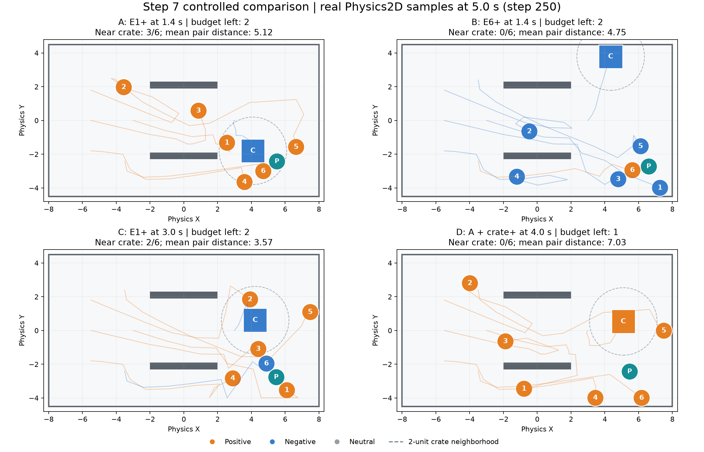
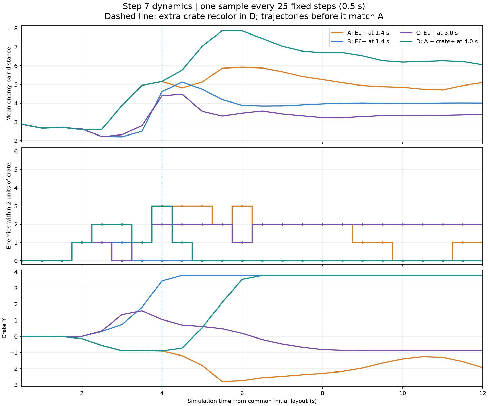

# 步骤 7：核心反馈实验 / 2026-10-10

步骤 7 两项验收通过。沿用步骤 6 的 Game、代码、Prefab 与 GameplayConfig，无需调参或新增玩法。固定六敌人、负极箱子、简单通道与三次预算，仅改变一次标记的目标、时机或增加一次箱子改色，即得到不同的传播路径和群体运动；可指出引导箱子附近、再拆散队伍及制造撞击的候选用途。实际避险、伤害、击杀与通关价值留在步骤 8—9 验证。

证据：[完整原始数据与 30 项检查](./步骤7-验收.json) · [5 秒位置对照](./步骤7-对照图.png) · [12 秒动态指标](./步骤7-指标图.png)。数据来自团结编辑器实际 Play 运行；图是采样数据图，不是 Game View 截图。

## 固定起点与复现方法

工程：团结 1.10.1 / 2022.3.62t13，基线提交 99a2370，场景 Assets/Polarity/Scenes/Game.scene。固定步长 0.02 秒；试验步号从共同起点开始，第 N 步标记在本步物理前消费，时间以 N×0.02 表示。

| ID | 对象 | 脚下坐标 | 初始极性 |
| --- | --- | --- | --- |
| 1 | Enemy | (-3, 0) | Neutral |
| 2 | Enemy_02 | (-5.5, 1.8) | Neutral |
| 3 | Enemy_03 | (-5.5, 0) | Neutral |
| 4 | Enemy_04 | (-5.5, -1.8) | Neutral |
| 5 | Enemy_05 | (-3.5, 2.4) | Neutral |
| 6 | Enemy_06 | (-3.5, -2.4) | Neutral |
| 7 | Crate | (3, 0) | Negative |

玩家出生点 (5, -2.5)，移动输入始终为零，但保留 Dynamic 刚体，可被实际碰撞推移。短墙位于 (0, ±2.1)，占地 4×0.4；其余墙、质量、阻尼、权限、追击与磁力参数都不改。磁力强度 20、半径 7、标记距离 7、全局安全速度 12、追击速度 3.2、驱动加速度上限 6。箱子初始已经是负极，不额外消耗标记。

每次重新进入 Play。Bridge 切换期间会自动推进少量步，试验开始前只恢复上述保存的坐标、初始极性与零速度，同步物理 Transform 并清理诊断，再开始计数；试验中不直接改坐标、速度、力、接触或传播结果。暂停精确用例调用原 SimulationWorld.FixedUpdate，仍由唯一入口执行真实 Physics2D.Simulate；标记使用 SubmitMark(ID, Positive)，移动通过现有 SampleMoveInput 提交零意图。每例推进 600 步（12 秒）。八个正式精确用例为四方案各两次全新 Play；两次完整结果 JSON 的 SHA256 完全一致。

四个连续用例由引擎真正的 FixedUpdate 推进，onBeforeRender 在指定逻辑步前提交相同请求。四例都在计划步消费标记，传播事件步号/极性及最终坐标与精确用例一致。另有四次探索及四次操作时间窗口测试，共 20 次 × 600 步 = 12000 次成功模拟，失败 0；最后另重开正常场景验证 50 步。

手动复看时重新进入 Play，不按 WASD，在下表时刻左键点击指定主体（E1 为最靠前敌人，E6 为左下敌人）。手动墙钟时间与工具步号不完全一致，可参考下文 ±0.2 秒窗口；严格复现应在编辑器使用现有 API 并按模拟步计时。尚无 R 重试，恢复起点须退出再进入 Play。

## 只改一个变量的四组对照

| 方案 | 主动操作 | 相对 A 唯一变量 | 第 250 步箱边敌人数* | 第 250 步敌人平均间距 | 第 400 步箱子位置 | 剩余预算 |
| --- | --- | --- | --- | --- | --- | --- |
| A / E1_early | 第 70 步（1.4 秒）将 E1 标为正极 | 基准 | 3 | 5.124 | (4.597, -2.293) | 2 |
| B / E6_early | 第 70 步将 E6 标为正极 | 首次对象 | 0 | 4.752 | (4.344, 3.785) | 2 |
| C / E1_late | 第 150 步（3.0 秒）将 E1 改为正极 | 首次时机 | 2 | 3.568 | (6.221, -0.819) | 2 |
| D / Box_flip200 | 同 A，再于第 200 步（4.0 秒）将箱子改为正极 | 增加一次箱子改色 | 0 | 7.029 | (4.786, 3.785) | 1 |

*箱边敌人数为脚下中心距箱子中心小于 2 的敌人数，不是碰撞或伤害数。平均间距为六敌人的 15 个唯一对象对中心距离平均值。接触步数为“该步至少存在一个敌人—箱子接触”的步数，每步最多计一次，不能当作独立撞击次数。

- A：110 步 1→5 正极，111 步 5→2/3 正极，234 步 1→4，235 步 4→6；六敌人最终全正极，与负极箱子保持吸引。在 600 步内有 338 个箱子接触步，箱子被带到房间右下侧。箱子接触的峰值法向相对速度 6.611、冲量 6.266，可作为后续碰撞伤害的候选情形。
- B：E6 的正极起点没有先覆盖前排；102 步负极箱子 7→1，153 步 1→5，154 步 5→3，155 步 3→2，169 步 3→4，以上均负极。五负极敌人与负极箱子排斥，单独的正极 E6 保留；箱子抵达上墙。箱子接触仅 2 步，峰值法向相对速度 1.019、冲量 0.733，传播源头、接触机会和撞击强度都不同于 A。
- C：改色前，102 步箱子 7→1、126 步 1→6 均负极；150 步只将 E1 改为正极，E6 保留已经收到的负极。随后 152 步 1→5、153 步 5→3、154 步 3→2、172 步 3→4 正极，形成五正一负。与 A 相比，第 250 步平均间距更小，箱子路径不同，证明晚改色会保留此前传播历史，而非追溯修改全部接收者。
- D：第 200 步之前与 A 的采样位置、传播事件完全相同。200 步改色使箱子本步累计磁力从 A 的 (-20.179, -5.152) 变为 (20.179, 5.152)，等大反向；实际物理运动随后分离。第 250 步箱边敌人数由 A 的 3 变为 0，平均间距由 5.124 增至 7.029；第 200—600 步箱子接触仅 3 步，A 为 226 步。运动变化也使 1→4 / 4→6 的实际接触传播从 234 / 235 步提前到 217 / 218 步，形成完整的“改色→受力→运动→接触→传播”因果链。

图中数字为敌人 ID，C 为箱子，P 为玩家；圆/方形为实际脚下碰撞占地尺寸（敌人/玩家半径 0.5，箱子边长 1.4，已计根缩放），墙与房间边界为布局示意。半秒采样轨迹用该对象第 250 步的极性着色，不表示轨迹每一段的历史极性。虚线圆只辅助观察 2 单位邻域。

## 候选用途、时间窗口与限制

A 可用一次早期标记将部分敌人引导到负极箱子附近，保留预算；D 在吸引已建立后花一次改色拆散箱边聚集并改变后续传播时机。A/B 的碰撞强度差异也给后续“制造撞击”提供测试起点。这里证明可主动影响位置、队形和接触，不把接触数较少或队形较散直接宣称为实际避险/击杀收益。

将 A 的首次标记分别改为第 60 / 80 步（1.2 / 1.6 秒），第 250 步箱边敌人数仍为 3 / 2；但最终颜色分别为四正两负、五正一负。早标记的引导机会有约 ±0.2 秒的已测余量，精确接收者和传播时序敏感。将 D 的箱子改色分别改为第 190 / 210 步（3.8 / 4.2 秒），第 250 步箱边敌人数均为 0，平均间距 7.081 / 6.747，箱子均移到上墙侧；改色拆散用途在这三个采样时机均成立。没有组合两个时机一起变化，未宣称整个连续区间都已测试。

所有标记实际 Applied 且在距离 7 内，仅主动操作扣次；传播免费，每例预算保持 2 或 1。位置/速度均有限，主方案最大速度不超过 7.989，未触及全局 12 的上限。最终保存资源、重开 50 步、退出 Play，物理模式恢复 FixedUpdate，Game dirty=false、Missing Script 0、Console 错误 0 / 警告 0；场景、三个 Prefab、配置和两份引擎设置文件哈希前后一致。

结果复现范围为本机、当前编辑器版本和设置。未做外部盲测、物理键鼠注入、独立构建、跨设备确定性、复杂凹形寻路或完整战斗验证。不会将此报告当作伤害、死亡、胜负、炮台或 R 重试的验收；这些规则保持后续步骤安排。
